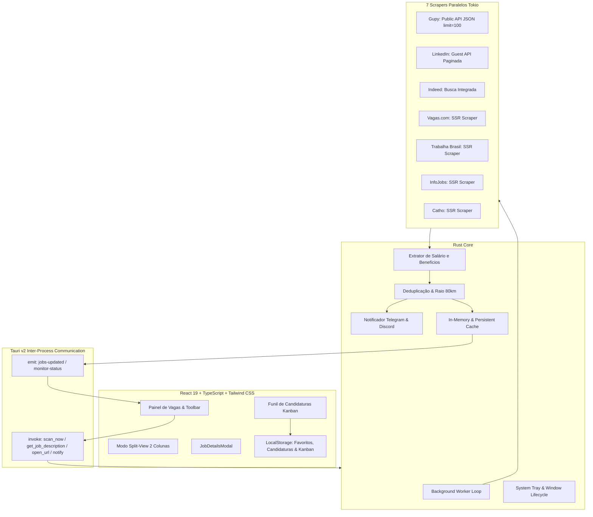

<div align="center">

# 💼 VagaFounder

**Monitor Desktop Inteligente de Oportunidades de Emprego em Tempo Real**

[](https://tauri.app/)
[](https://www.rust-lang.org/)
[](https://react.dev/)
[](https://www.typescriptlang.org/)
[](https://tailwindcss.com/)
[](LICENSE)

*Desenvolvido com foco em alta performance nativa, baixo consumo de memória e máxima produtividade na busca por vagas de emprego.*

**by: MateusDeveloper**

---

</div>

## 📌 Sobre o VagaFounder

O **VagaFounder** é uma aplicação desktop nativa desenvolvida com o ecossistema **Tauri v2 (Rust)** no backend e **React 19 + TypeScript + Tailwind CSS** no frontend. 

A aplicação automatiza a busca e o monitoramento contínuo de vagas nas **7 maiores plataformas de contratação do Brasil**:
1. 🏢 **Gupy** (API JSON Oficial em Lotes de 100)
2. 💼 **LinkedIn** (Guest API Paginada em Lotes)
3. 🔎 **Indeed** (Busca Integrada Resiliente)
4. 📄 **Vagas.com** (Web Scraper SSR com Extração de Salário)
5. 🇧🇷 **Trabalha Brasil / SINE** (Web Scraper SSR Direto)
6. 🎯 **InfoJobs** (Web Scraper SSR com Cards Semânticos)
7. 🌟 **Catho** (Web Scraper SSR para Vagas Abertas)

Com suporte a escopo geográfico regional (**Recife e região metropolitana em até 80 km**) e vagas **Remotas em todo o Brasil**, o VagaFounder filtra oportunidades para diferentes perfis profissionais: desde *Jovem Aprendiz*, *Estágio* e *Auxiliar Administrativo* até *Suporte de TI*, *Recursos Humanos (RH)* e *Desenvolvimento de Software*.

---

## ✨ Principais Funcionalidades (Versão 1.1.0)

### 🏆 Funil de Candidaturas (Kanban de Processos Seletivos)
* **Gestão Visual Completa:** Acompanhe suas vagas em 5 colunas estruturadas:
  - 📝 **Interesse** (vagas que pretendo me candidatar)
  - ✉️ **Inscrito** (currículo enviado)
  - 💬 **Entrevista / Teste** (em contato ou processo seletivo)
  - ⏳ **Aguardando Retorno** (feedback da empresa)
  - 🎉 **Aprovado / Proposta** (ofertas e conquistas)
* **Ações Instantâneas:** Envie qualquer vaga da busca ou tabela diretamente para o Funil com 1 clique.
* **Anotações de Progresso:** Adicione anotações inline para registrar datas de entrevistas, contatos do recrutador ou feedbacks.
* **Cadastro Manual de Vagas:** Cadastre oportunidades externas (ex: indicações, WhatsApp, e-mail) com empresa, salário, localidade e link.

### 📱 Notificações Externas (Telegram & Discord)
* **Integração Telegram Bot:** Receba alertas instantâneos no seu celular via bot do Telegram com mensagem HTML formatada (título, empresa, local, salário, benefícios e botão direto para candidatura).
* **Integração Discord Webhook:** Notifique canais ou servidores no Discord via Rich Embeds com cores personalizadas e botões de ação.
* **Painel de Teste:** Teste e valide a conexão com o Telegram e Discord com 1 clique na aba de Configurações.

### 💰 Extrator Inteligente de Salário & Benefícios em Destaque
* **Parser de Remuneração:** Extrai automaticamente faixas salariais em Real (R$) presentes no título ou na descrição da vaga.
* **Extrator de Benefícios:** Identifica e destaca tags visuais de benefícios como:
  - Vale Refeição (VR) & Vale Alimentação (VA)
  - Vale Transporte (VT)
  - Plano de Saúde & Odontológico
  - Home Office / Trabalho Remoto
  - Gympass / TotalPass
  - Seguro de Vida
  - Participação nos Lucros (PLR)
  - Day Off de Aniversário
* **Filtros Rápidos:** Botões na toolbar para filtrar instantaneamente *"Apenas Vagas com Salário"* e *"Apenas Vagas com Benefícios"*.

### 🖥️ Split-View & Modos de Visualização
* **Modo Tabela Completa:** Ideal para visão analítica e triagem rápida com paginação de 25, 50 ou 100 vagas por página.
* **Modo Grade / Cards:** Visualização moderna em cartões com destaques visuais de empresa, localidade, remuneração e benefícios.
* **Modo Split-View (2 Colunas):** Lista rápida à esquerda e pré-visualização completa fixa à direita com descrição integral da vaga, sem precisar abrir modais.

### 🌓 Dark Mode & Acessibilidade Total
* **Tema Escuro Nativo:** Alternador de Modo Claro / Modo Escuro persistido localmente e calibrado para alto contraste e conforto visual.
* **Navegação 100% por Teclado:**
  - `Ctrl + K` ou `/`: Foca instantaneamente na barra de busca.
  - `↑` e `↓`: Navega entre as vagas da lista e atualiza o Split-View.
  - `Espaço`: Abre o pop-up com todos os detalhes da vaga.
  - `F`: Salva ou remove a vaga dos favoritos.
  - `Enter`: Abre o link oficial de candidatura no navegador padrão.
  - `Esc`: Fecha o modal ou limpa o campo de busca.

### 🩺 Health Check & Monitor de Fontes
* Monitor em tempo real na aba de Configurações com status operacional, protocolo de conexão, latência estimada e contagem de vagas indexadas para cada uma das 7 plataformas.

---

## 🏗️ Arquitetura do Sistema



---

## 🛠️ Tecnologias Utilizadas

| Camada | Tecnologia | Descrição |
|---|---|---|
| **Shell Nativo** | [Tauri v2](https://tauri.app/) | Runtime desktop ultra-leve baseado em WebView2 (Windows) e WebKit (Linux/macOS) |
| **Backend** | [Rust](https://www.rust-lang.org/) | Concorrência assíncrona com `tokio`, parsing seguro e consumo mínimo de memória RAM |
| **Scraping & HTTP** | [Reqwest](https://docs.rs/reqwest/) + [Scraper](https://docs.rs/scraper/) | Requisições HTTP concorrentes com controle de semáforo e seletores CSS |
| **Frontend** | [React 19](https://react.dev/) | Interface declarativa de alta reatividade |
| **Linguagem Frontend** | [TypeScript](https://www.typescriptlang.org/) | Tipagem estrita ponta a ponta |
| **Estilização & Tema** | [Tailwind CSS v3](https://tailwindcss.com/) | Design moderno com suporte nativo a Dark Mode e Split-View |
| **Ícones & Datas** | [Lucide React](https://lucide.dev/) + [Date-fns](https://date-fns.org/) | Ícones consistentes e formatação de datas em pt-BR |
| **Bundler** | [Vite 5](https://vitejs.dev/) | HMR instantâneo e compilação otimizada |

---

## 📦 Como Instalar e Rodar Localmente

### Pré-requisitos
1. **Node.js**: versão 18 ou superior.
2. **Rust & Cargo**: versão estável recomendada ([instalar via rustup](https://rustup.rs/)).
3. **Microsoft C++ Build Tools & WebView2** (no Windows).

### Passo a Passo

1. **Clone o repositório:**
   ```bash
   git clone https://github.com/mssmateusdev/vagafounder-app.git
   cd vagafounder-app
   ```

2. **Instale as dependências:**
   ```bash
   npm install
   ```

3. **Inicie em modo de desenvolvimento:**
   ```bash
   npm run tauri:dev
   ```

---

## 🔨 Como Gerar os Instaladores de Produção

### Build Local (Windows)
```bash
npm run tauri:build
```
Os arquivos gerados ficarão disponíveis em:
- **Instalador NSIS (.exe):** `src-tauri/target/release/bundle/nsis/VagaFounder_1.1.0_x64-setup.exe`
- **Pacote MSI (.msi):** `src-tauri/target/release/bundle/msi/VagaFounder_1.1.0_x64_en-US.msi`

---

## 📄 Licença

Este projeto é distribuído sob a licença **MIT**. Consulte o arquivo `LICENSE` para mais detalhes.

---

<div align="center">

Desenvolvido com dedicação por **MateusDeveloper** 🚀  
Se este projeto foi útil para você, deixe uma ⭐ no repositório!

</div>
